<p align="center">
  
</p>

# SMKN 24 Jakarta

Website publik dan dashboard admin SMK Negeri 24 Jakarta. Aplikasi yang
digunakan dan dikembangkan saat ini berada di `penggabungan-monorepo/`.
Folder `apps/main-web/`, `apps/admin/`, dan `packages/` di root adalah
monorepo versi lama; strukturnya masih tersedia sebagai referensi, tetapi
bukan source of truth dan tidak selalu memuat fitur terbaru.

## Struktur repository

```text
.
├── penggabungan-monorepo/  # Aplikasi aktif: Next.js publik + dashboard admin
│   ├── app/
│   ├── backend/            # Backend PHP native, direkomendasikan
│   └── backend-laravel/    # Backend hasil migrasi, masih tertinggal pada beberapa fitur
├── apps/                   # Aplikasi monorepo lama; bukan target pengembangan aktif
├── packages/               # Paket monorepo lama
├── .assets/                # Aset dokumentasi
└── README.md
```

Untuk fitur, instalasi, perintah, atau konfigurasi aplikasi aktif, lihat
[penggabungan-monorepo/README.md](penggabungan-monorepo/README.md).

## Memilih backend

Aplikasi aktif dapat diarahkan ke salah satu dari dua backend. **PHP native
direkomendasikan untuk penggunaan saat ini**, karena menerima sejumlah
pembaruan yang belum tersedia di Laravel, termasuk Hub Industri. Laravel
merupakan hasil migrasi yang dapat dipilih untuk pengembangan atau uji migrasi,
tetapi jangan menganggap fitur dan perilakunya sudah sepenuhnya setara dengan
PHP.

| Backend | Lokasi | Gunakan saat |
|---|---|---|
| PHP native | `penggabungan-monorepo/backend/` | Pilihan yang disarankan untuk mendapatkan fitur terbaru |
| Laravel | `penggabungan-monorepo/backend-laravel/` | Menguji hasil migrasi atau menjalankan fitur Laravel yang sudah tersedia; periksa gap fitur terlebih dahulu |

Pilih satu backend sebagai API aktif untuk satu proses frontend. Jangan
mengarahkan API browser dan server ke backend berbeda untuk operasi tulis, dan
jangan menjalankan dua backend untuk menulis ke database yang sama secara
bersamaan. Keduanya memakai format kompatibilitas endpoint lama, tetapi
kesetaraan fitur tidak dijamin.

## Konfigurasi frontend

Atur environment di `penggabungan-monorepo/.env.local` **sebelum** menjalankan
development server atau build. Variabel `NEXT_PUBLIC_*` ditanam ke bundle saat
build; perubahan sesudah build memerlukan build ulang.

```env
# PHP native
BACKEND_URL=http://127.0.0.1:8000/backend
NEXT_PUBLIC_API_URL=http://127.0.0.1:8000/backend
NEXT_PUBLIC_ASSET_URL=http://127.0.0.1:8000
NEXT_PUBLIC_MAIN_WEB_URL=/
```

Untuk memilih Laravel, ganti base API browser dan tambahkan URL Laravel
server-side. Pertahankan URL PHP untuk aset lama seperti
`/backend/uploads/...`:

```env
# PHP tetap melayani aset legacy; Laravel menjadi API aktif
BACKEND_URL=https://domain-anda.id/backend
LARAVEL_API_URL=http://127.0.0.1:8001
NEXT_PUBLIC_API_URL=http://127.0.0.1:8001
NEXT_PUBLIC_ASSET_URL=https://domain-anda.id
NEXT_PUBLIC_MAIN_WEB_URL=/
```

Jika memakai PHP native, hapus atau jangan set `LARAVEL_API_URL`; server
Next.js akan memakai `BACKEND_URL` sebagai API. Jika API Laravel berada di
domain lain, ganti kedua URL Laravel dengan origin tersebut. Ikuti CORS dan
konfigurasi aset pada README aplikasi.

## Pengembangan lokal singkat

Terminal pertama: dari folder aplikasi aktif, jalankan salah satu backend.

```powershell
cd penggabungan-monorepo
php -S 127.0.0.1:8000 -t .
```

Untuk Laravel, jalankan sebagai gantinya:

```powershell
cd penggabungan-monorepo\backend-laravel
php artisan serve --host=127.0.0.1 --port=8001
```

Terminal kedua: dari `penggabungan-monorepo/`, jalankan frontend:

```powershell
npm install
npm run dev
```

Buka <http://localhost:3000>. Sesuaikan `.env.local` dengan backend yang
dijalankan. Jangan arahkan operasi tulis lokal ke database produksi.

## Database dan secret

- Untuk database baru, impor `penggabungan-monorepo/backend/database.sql`
  satu kali ke database yang memang kosong.
- Untuk database berisi data sekolah, jangan impor ulang `database.sql`.
  Tinjau migration backend yang dipilih dan buat backup sebelum perubahan
  schema.
- Konfigurasi PHP disimpan di `penggabungan-monorepo/backend/.env`;
  konfigurasi Laravel di `penggabungan-monorepo/backend-laravel/.env`.
- Gunakan `JWT_SECRET` yang sesuai dengan backend aktif agar token login
  kompatibel. Simpan credential DB dan kunci AI hanya di environment backend.
- Kedua backend tidak memiliki guard aplikasi yang menolak operasi tulis
  berdasarkan environment atau host database. Periksa target database sebelum
  menjalankan server lokal, CRUD, atau migration.
- Jangan commit `.env`, `.env.local`, token, password, atau secret.

## Build dan validasi frontend

Jalankan dari `penggabungan-monorepo/`:

```bash
npm run lint
npm run typecheck
npm run build
npm run start
```

README aplikasi aktif memuat detail endpoint, deployment, database, dan
konfigurasi masing-masing backend.
